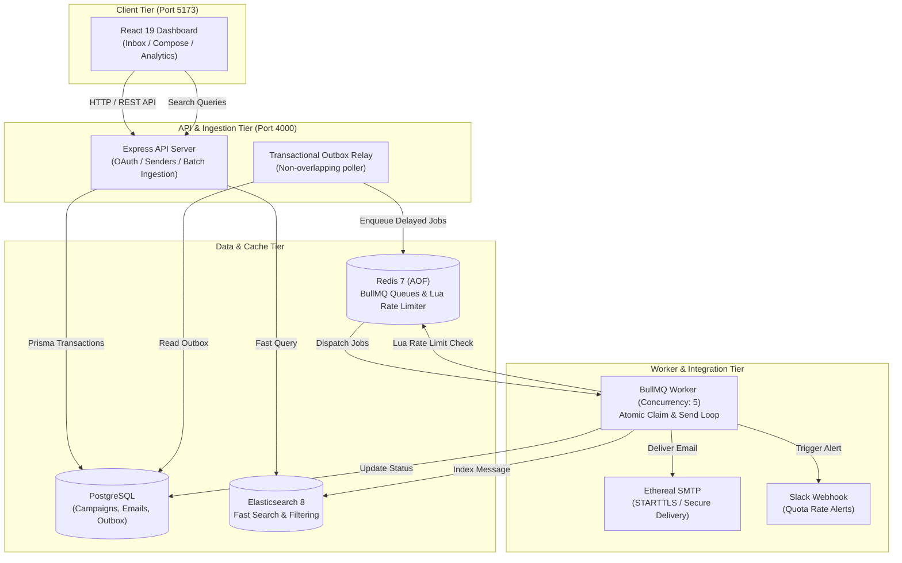

# ReachInbox - High-Throughput Email Scheduler & Outbox Engine

A distributed, production-grade email scheduling system and analytics dashboard built with **TypeScript**, **Node.js/Express**, **PostgreSQL (Prisma)**, **Redis (BullMQ)**, **Elasticsearch**, and **React 19 (Tailwind CSS)**.


---

## 🚀 Key Features

- **Distributed Queueing & Outbox Pattern**: Implements a transactional outbox in PostgreSQL paired with BullMQ delayed jobs to guarantee persistence and prevent duplicate sends across restarts.
- **Intelligent Dynamic Rate Limiting**: Redis Lua scripts atomically enforce per-sender hourly limits, global send delays, and campaign quotas using Redis server time to prevent clock drift issues.
- **Multi-Sender SMTP Delivery**: Connect and manage multiple SMTP senders (configured for Ethereal test accounts) with credentials encrypted at rest using **AES-256-GCM**.
- **Slack Alert Integrations**: Real OAuth 2.0 and incoming-webhook integration that triggers live notifications to your Slack channel when sender quotas are reached.
- **Fast Full-Text Search**: Scheduled and sent emails are indexed in **Elasticsearch 8** with versioned document synchronizers for instant status filtering, recipient search, and pagination.
- **Google OAuth 2.0 Authentication**: Authorization Code flow with PKCE, audience-verified ID tokens, and secure HTTP-only SameSite session cookies.
- **Modern Responsive Dashboard**: React 19 dashboard styled with Tailwind CSS, featuring a CSV/text lead upload parser with chip deduplication, real-time message previews, and modal composers.
- **Queue Observability**: Integrated [Bull Board](http://localhost:5173/admin/queues) administrative dashboard for real-time visibility into active, delayed, and completed email jobs.

---

## 🏗️ Architecture & Data Flow



---

## 🛠️ Tech Stack

| Domain | Technologies |
| :--- | :--- |
| **Backend API** | TypeScript, Express 5, Node.js 22+, Helmet, Zod |
| **Database & ORM** | PostgreSQL 16, Prisma ORM (Client v6) |
| **Queues & Throttling** | Redis 7, BullMQ, Redis Lua Scripts |
| **Search Engine** | Elasticsearch 8.15 |
| **Email Protocol** | Nodemailer, Ethereal SMTP with STARTTLS |
| **Frontend UI** | React 19, TypeScript, Vite, Tailwind CSS, Lucide Icons |
| **Queue Admin** | Bull Board (`@bull-board/express`) |
| **Integrations** | Google OAuth (PKCE), Slack Webhooks & OAuth 2.0 |

---

## ⚡ Quick Start Guide

### 1. Prerequisites
- **Node.js** v22+ and **npm**
- **Docker Desktop** (for PostgreSQL, Redis, and Elasticsearch)

---

### 2. Environment Configuration
Copy the sample environment file to `.env`:

```bash
cp .env.example .env
```

Generate secure random secrets:
```bash
node -e "console.log(require('crypto').randomBytes(32).toString('hex'))"
```
Update your `.env` with:
- `JWT_SECRET`: Random 32+ character string
- `ENCRYPTION_KEY`: Exactly 64 hexadecimal characters (32 bytes)
- `QUEUE_ADMIN_PASSWORD`: Custom dashboard password

---

### 3. Start Infrastructure Services
Launch PostgreSQL, Redis, and Elasticsearch via Docker Compose:

```bash
docker compose up -d
```

---

### 4. Database Setup
Generate the Prisma client and apply the database migrations:

```bash
npm run db:generate
npm run db:migrate
```

---

### 5. Run the Application
Start the API server, background worker, and frontend dashboard with a single command:

```bash
npm run dev
```

| Application Service | Local URL |
| :--- | :--- |
| **Frontend Web App** | [http://localhost:5173](http://localhost:5173) |
| **Backend API Health Check** | [http://localhost:4000/api/health](http://localhost:4000/api/health) |
| **BullMQ Queue Monitor** | [http://localhost:5173/admin/queues](http://localhost:5173/admin/queues) |

---

## 🔌 API Overview

### Email Scheduling
`POST /api/emails/schedule`
```json
{
  "senderId": "cm3senderuuid001",
  "recipients": ["client1@example.com", "client2@example.com"],
  "subject": "Q4 Performance Review",
  "body": "Hi there,\nHere is the updated performance report.",
  "startAt": "2026-11-01T09:30:00+05:30",
  "delayMs": 2000,
  "hourlyLimit": 200
}
```
*Supports `Idempotency-Key` headers for safe batch re-execution.*

### Senders Management
- `GET /api/senders` — List configured senders and hourly allocations.
- `POST /api/senders` — Add a verified Ethereal SMTP sender with encrypted credentials.

### Search & Analytics
- `GET /api/emails?status=SCHEDULED&query=search-term&page=1` — Query scheduled and delivered emails via Elasticsearch with pagination.

---

## 🛡️ Reliability & Fault-Tolerance Highlights

- **Crash-Proof Restart Recovery**: Redis is configured with `appendonly yes` and `appendfsync always`. The worker additionally synchronizes pending database outbox rows on boot to resume any interrupted workflows.
- **Duplicate Prevention**: Workers atomically claim email rows using database-level locking and deterministic BullMQ Job IDs.
- **Non-blocking Quota Overflow**: When a sender hits their hourly quota, jobs are rescheduled with `moveToDelayed` to the beginning of the next UTC hour without burning retry attempts.
- **Graceful Search Fallback**: Transparent Elasticsearch external document versioning ensures concurrent state transitions don't corrupt indexed documents.

---

## 🧪 Testing & Verification

Run the automated test suites:

```bash
# Run unit tests across workspaces
npm test

# Run Redis rate limiting integration tests
npm run test:integration --workspace backend
```

---

## 📂 Project Structure

```
├── backend/
│   ├── prisma/             # Database schema & migrations
│   ├── src/
│   │   ├── auth.ts         # Google OAuth & session management
│   │   ├── crypto.ts       # AES-256-GCM encryption utilities
│   │   ├── notifications.ts# Slack rate alert delivery
│   │   ├── queue.ts        # BullMQ queue & Redis client
│   │   ├── rate-limit.ts   # Redis Lua throttling logic
│   │   ├── relay.ts        # Outbox synchronization relay
│   │   ├── routes/         # Express REST API routes
│   │   ├── scheduling.ts   # Timezone-aware batch scheduling engine
│   │   ├── search.ts       # Elasticsearch client & indexing
│   │   ├── server.ts       # Express app & middleware entry
│   │   └── worker.ts       # BullMQ processor & SMTP delivery
│   └── test/               # Scheduling and rate limiting tests
├── frontend/
│   ├── src/
│   │   ├── components/     # Inbox, Compose, SenderDialog, Login, UI
│   │   ├── api.ts          # Backend API client
│   │   ├── leads.ts        # CSV & raw text parser
│   │   └── styles.css      # Tailwind styling
│   └── test/               # Lead parser & visual test fixtures
├── docker-compose.yml      # PostgreSQL, Redis, Elasticsearch
└── package.json            # Root workspace definitions & scripts
```

---

## 📄 License
This project is submitted as an evaluation assessment for ReachInbox.
