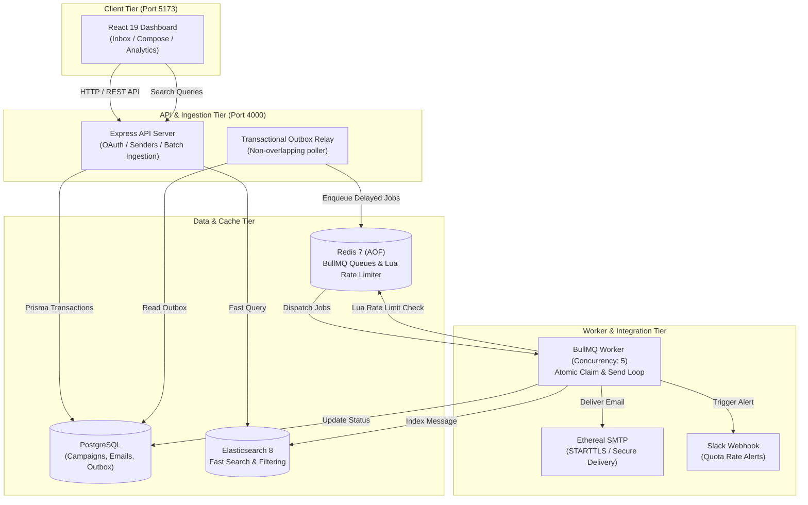

# Outbox Labs - High-Throughput Email Scheduler & Outbox Engine

A distributed, production-grade email scheduling system and analytics dashboard built with **TypeScript**, **Node.js/Express**, **PostgreSQL (Prisma)**, **Redis (BullMQ)**, **Elasticsearch**, and **React 19 (Tailwind CSS)**.


---

## Table of Contents
1. [Key Features](#key-features)
2. [Architecture & Data Flow](#architecture--data-flow)
3. [Tech Stack](#tech-stack)
4. [Prerequisites](#prerequisites)
5. [Step-by-Step Installation & Setup](#step-by-step-installation--setup)
   - [Step 1: Clone & Install Dependencies](#step-1-clone--install-dependencies)
   - [Step 2: Environment Configuration](#step-2-environment-configuration)
   - [Step 3: Google OAuth Configuration](#step-3-google-oauth-configuration)
   - [Step 4: Slack OAuth & Webhook Alerts Configuration](#step-4-slack-oauth--webhook-alerts-configuration)
   - [Step 5: Launch Infrastructure with Docker](#step-5-launch-infrastructure-with-docker)
   - [Step 6: Database Initialization & Migrations](#step-6-database-initialization--migrations)
6. [Running the Application](#running-the-application)
   - [Option A: One-Command All-in-One Runner](#option-a-one-command-all-in-one-runner-recommended)
   - [Option B: Separate Terminals for Debugging](#option-b-separate-terminals-for-debugging)
7. [Application Access Endpoints](#application-access-endpoints)
8. [Step-by-Step Demo & Verification Walkthrough](#step-by-step-demo--verification-walkthrough)
   - [1. User Authentication](#1-user-authentication)
   - [2. Add Ethereal SMTP Senders](#2-add-ethereal-smtp-senders)
   - [3. Connect Slack for Rate Alerts](#3-connect-slack-for-rate-alerts)
   - [4. Compose & Schedule Email Batch](#4-compose--schedule-email-batch)
   - [5. Test Rate Limiting & Live Slack Notification](#5-test-rate-limiting--live-slack-notification)
   - [6. Test Server Restart Persistence](#6-test-server-restart-persistence)
   - [7. Fast Search & Email Previews](#7-fast-search--email-previews)
9. [Monitoring & Queues Dashboard (Bull Board)](#monitoring--queues-dashboard-bull-board)
10. [Automated Testing & Builds](#automated-testing--builds)
11. [REST API Documentation](#rest-api-documentation)
12. [Troubleshooting & Common Questions](#troubleshooting--common-questions)
13. [Project Structure](#project-structure)
14. [Submission & Evaluation](#submission--evaluation)

---

## Key Features

- **Distributed Queueing & Outbox Pattern**: Implements a transactional outbox in PostgreSQL paired with BullMQ delayed jobs to guarantee persistence and prevent duplicate sends across restarts.
- **Intelligent Dynamic Rate Limiting**: Redis Lua scripts atomically enforce per-sender hourly limits, global send delays, and campaign quotas using Redis server time to prevent clock drift issues.
- **Multi-Sender SMTP Delivery**: Connect and manage multiple SMTP senders (configured for Ethereal test accounts) with credentials encrypted at rest using **AES-256-GCM**.
- **Slack Alert Integrations**: Real OAuth 2.0 and incoming-webhook integration that triggers live notifications to your Slack channel when sender quotas are reached.
- **Fast Full-Text Search**: Scheduled and sent emails are indexed in **Elasticsearch 8** with versioned document synchronizers for instant status filtering, recipient search, and pagination.
- **Google OAuth 2.0 Authentication**: Authorization Code flow with PKCE, audience-verified ID tokens, and secure HTTP-only SameSite session cookies.
- **Modern Responsive Dashboard**: React 19 dashboard styled with Tailwind CSS, featuring a CSV/text lead upload parser with chip deduplication, real-time message previews, and modal composers.
- **Queue Observability**: Integrated Bull Board administrative dashboard for real-time visibility into active, delayed, and completed email jobs.

---

## Architecture & Data Flow



---

## Tech Stack

| Domain | Technologies |
| :--- | :--- |
| **Backend API** | TypeScript, Express 5, Node.js 22+, Helmet, Zod |
| **Database & ORM** | PostgreSQL 16, Prisma ORM (Client v6) |
| **Queues & Throttling** | Redis 7, BullMQ, Redis Lua Scripts |
| **Search Engine** | Elasticsearch 8.15 |
| **Email Protocol** | Nodemailer, Ethereal SMTP with STARTTLS |
| **Frontend UI** | React 19, TypeScript, Vite, Tailwind CSS, Lucide Icons |
| **Queue Admin** | Bull Board (`@bull-board/express`) |
| **Integrations** | Google OAuth (PKCE), Slack Webhooks & OAuth 2.0 |

---

## Prerequisites

Before running the application, ensure you have the following installed on your machine:
- **Node.js**: v22+ (verified with Node 22 and 24)
- **npm**: v10+
- **Docker Desktop**: Running Docker daemon for PostgreSQL, Redis, and Elasticsearch
- A modern web browser (Google Chrome, Firefox, or Edge)

---

## Step-by-Step Installation & Setup

### Step 1: Clone & Install Dependencies
Clone the repository and install all workspace dependencies from the root directory:

```bash
# Clone the repository
git clone https://github.com/Bhanu-partap-13/Outbox-assesment.git
cd Outbox-assesment

# Install dependencies across all workspaces (root, backend, and frontend)
npm install
```

---

### Step 2: Environment Configuration
Copy the sample environment file to create your local `.env`:

```bash
cp .env.example .env
```

Generate secure cryptographic keys using Node.js:
```bash
node -e "console.log(require('crypto').randomBytes(32).toString('hex'))"
```

Open `.env` and fill in the required variables:
- `JWT_SECRET`: A secure 32+ character random string (for user session cookies).
- `ENCRYPTION_KEY`: Exactly **64 hexadecimal characters** (used for AES-256-GCM encryption of SMTP passwords and Slack webhooks).
- `QUEUE_ADMIN_USER`: Username for Bull Board admin queue monitor (e.g. `admin`).
- `QUEUE_ADMIN_PASSWORD`: Secure password for Bull Board queue monitor.

---

### Step 3: Google OAuth Configuration
1. Open the [Google Cloud Console](https://console.cloud.google.com/).
2. Create a new project (e.g. `ReachInbox Scheduler`).
3. Under **APIs & Services** -> **OAuth consent screen**:
   - Choose **External** user type.
   - Fill in the App Name and user support email.
   - Add your email under **Test users**.
4. Under **APIs & Services** -> **Credentials**:
   - Click **Create Credentials** -> **OAuth client ID**.
   - Select Application type: **Web application**.
   - Add Authorized redirect URI:
     ```text
     http://localhost:5173/api/auth/google/callback
     ```
5. Copy the generated **Client ID** and **Client Secret** into your `.env`:
   ```env
   GOOGLE_CLIENT_ID=your_google_client_id_here
   GOOGLE_CLIENT_SECRET=your_google_client_secret_here
   ```

---

### Step 4: Slack OAuth & Webhook Alerts Configuration
1. Open the [Slack API Portal](https://api.slack.com/apps) and click **Create New App** (From scratch).
2. Choose a workspace where you want rate limit notifications delivered.
3. Under **Features** -> **OAuth & Permissions**:
   - Add Redirect URL:
     ```text
     http://localhost:5173/api/integrations/slack/callback
     ```
   - Under **Scopes** -> **Bot Token Scopes**, add `incoming-webhook`.
4. Under **Settings** -> **Basic Information**, copy the **Client ID** and **Client Secret** to your `.env`:
   ```env
   SLACK_CLIENT_ID=your_slack_client_id_here
   SLACK_CLIENT_SECRET=your_slack_client_secret_here
   ```

---

### Step 5: Launch Infrastructure with Docker
Start PostgreSQL, Redis, and Elasticsearch containers in detached mode:

```bash
docker compose up -d
```

Verify that all three services are healthy:
```bash
docker ps
```
You should see:
- `postgres:16-alpine` on port `5432`
- `redis:7-alpine` on port `6379`
- `elasticsearch:8.15.1` on port `9200`

---

### Step 6: Database Initialization & Migrations
Generate the Prisma Client and apply the database schema migration:

```bash
# Generate Prisma Client
npm run db:generate

# Apply database migration
npm run db:migrate
```

---

## Running the Application

### Option A: One-Command All-in-One Runner (Recommended)
You can run all three processes (Backend API, BullMQ Worker, and Vite Frontend) simultaneously using:

```bash
npm run dev
```

This starts:
- **Backend API**: Running on `http://localhost:4000`
- **BullMQ Queue Worker**: Concurrently processing email jobs and rate limits
- **Frontend Web App**: Running on `http://localhost:5173`

---

### Option B: Separate Terminals for Debugging
If you prefer viewing separate logs for each process, open three terminal tabs:

**Terminal 1 - Backend API Server:**
```bash
npm run dev --workspace backend
```

**Terminal 2 - BullMQ Queue Worker:**
```bash
npm run worker --workspace backend
```

**Terminal 3 - Frontend React Application:**
```bash
npm run dev --workspace frontend
```

---

## Application Access Endpoints

| Service | Address | Description |
| :--- | :--- | :--- |
| **Frontend Web App** | [http://localhost:5173](http://localhost:5173) | Main user interface (Inbox, Compose, Senders) |
| **Backend API Health** | [http://localhost:4000/api/health](http://localhost:4000/api/health) | System health and database connectivity |
| **Dependency Readiness** | [http://localhost:4000/api/ready](http://localhost:4000/api/ready) | Readiness checks for DB, Redis, and Elasticsearch |
| **BullMQ Queue Dashboard** | [http://localhost:5173/admin/queues](http://localhost:5173/admin/queues) | Visual background queue monitoring |

---

## Step-by-Step Demo & Verification Walkthrough

Follow this 5-minute flow to verify all project requirements:

### 1. User Authentication
1. Open [http://localhost:5173](http://localhost:5173).
2. Click **Sign in with Google**.
3. Complete the Google consent screen. Upon redirect, the dashboard will display your Google account name, email, and avatar.

### 2. Add Ethereal SMTP Senders
1. Open [Ethereal Email](https://ethereal.email/create) in a new tab to create two free test SMTP accounts.
2. In the dashboard header, click **Compose** -> **Add Sender**.
3. Enter:
   - **Sender Name**: e.g., `Primary Outreach`
   - **Ethereal Email Address**
   - **Ethereal Password**
   - **Hourly Limit**: `2` (set to 2 for quick quota demonstration)
4. Click **Save Sender**. The backend verifies credentials via STARTTLS before saving and encrypts the password with AES-256-GCM.
5. Repeat for a second test sender.

### 3. Connect Slack for Rate Alerts
1. Click **Connect Slack** in the top navigation bar.
2. Complete the authorization and pick the target Slack channel.
3. The dashboard will now reflect the active Slack integration status.

### 4. Compose & Schedule Email Batch
1. Click **Compose New Email**.
2. Upload a sample CSV file or enter comma-separated email addresses:
   ```csv
   email
   john.doe@example.com
   jane.smith@example.com
   john.doe@example.com
   alex.jones@example.com
   ```
3. Notice that the lead parser detects **3 unique recipients** and automatically discards the duplicate.
4. Fill in:
   - **Subject**: `Q4 Platform Updates`
   - **Body**: Plain text email content
   - **Start Time**: 1 minute from now
   - **Delay Between Emails**: `2000` ms (2 seconds)
   - **Batch Hourly Cap**: `2`
5. Click **Schedule Emails**.

### 5. Test Rate Limiting & Live Slack Notification
1. Open the [Bull Board Dashboard](http://localhost:5173/admin/queues) to see the 3 delayed jobs in the queue.
2. When the start time arrives:
   - Email 1 is sent.
   - Email 2 is sent (hitting the hourly quota of 2).
   - Email 3 is atomically postponed using `moveToDelayed` to the beginning of the next UTC hour.
3. Check your Slack channel: an instant webhook alert notification arrives notifying you that the sender hit their hourly quota!

### 6. Test Server Restart Persistence
1. While jobs are queued, stop the backend and worker processes (`Ctrl+C` in the terminal).
2. Keep Docker running (PostgreSQL and Redis AOF remain intact).
3. Restart the backend and worker (`npm run dev`).
4. On startup, the worker runs outbox reconciliation: **no jobs are duplicated or lost**, and jobs resume execution automatically.

### 7. Fast Search & Email Previews
1. Go to the **Sent** view in the inbox table.
2. Type a subject keyword in the search bar - search queries run against **Elasticsearch 8** with sub-50ms latency.
3. Click on any sent email to open the details modal and click the **Ethereal Preview Link** to view the real rendered email in Ethereal.

---

## Monitoring & Queues Dashboard (Bull Board)

The application includes an integrated Bull Board monitoring dashboard at:
[http://localhost:5173/admin/queues](http://localhost:5173/admin/queues)

- Authenticate using the `QUEUE_ADMIN_USER` and `QUEUE_ADMIN_PASSWORD` defined in your `.env`.
- Inspect real-time job states: `Waiting`, `Active`, `Delayed`, `Completed`, and `Failed`.
- View job payloads, execution delays, retry attempts, and stack traces.

---

## Automated Testing & Builds

Run test suites and builds to ensure zero regressions:

```bash
# Run all unit tests (scheduling, timezone normalization, CSV parser)
npm test

# Run Redis rate limiting integration tests
npm run test:integration --workspace backend

# Verify production builds for both backend and frontend
npm run build
```

---

## REST API Documentation

### Schedule Email Batch
`POST /api/emails/schedule`

**Headers:**
- `Content-Type: application/json`
- `Idempotency-Key`: Unique UUID string (8–128 characters)

**Request Body:**
```json
{
  "senderId": "clx9v000108l41b2c3d4e5f6g",
  "recipients": ["user1@example.com", "user2@example.com"],
  "subject": "Quarterly Update",
  "body": "Hi there,\nPlease find our latest release notes.",
  "startAt": "2026-11-01T10:00:00+05:30",
  "delayMs": 2000,
  "hourlyLimit": 200
}
```

### Senders
- `GET /api/senders` - List configured senders and hourly usage.
- `POST /api/senders` - Add and verify a new Ethereal SMTP sender.

### Emails & Search
- `GET /api/emails?status=SCHEDULED&page=1&limit=25` - List scheduled emails.
- `GET /api/emails?status=SENT&query=Quarterly` - Search sent emails via Elasticsearch.

---

## Troubleshooting & Common Questions

#### 1. Docker Desktop daemon error
*Error*: `failed to connect to the docker API at npipe://...`  
*Solution*: Start the Docker Desktop application on Windows and ensure the Docker engine is running before executing `docker compose up -d`.

#### 2. Port Conflicts
If ports `5432`, `6379`, or `9200` are already in use by local services, stop the local services or modify the port mapping in [`docker-compose.yml`](file:///e:/Users/Ritesh%20Sinha/Desktop/PROJECTS/BHANU%20ASSESMENT/docker-compose.yml).

#### 3. Database Migration Error
If migrations fail due to an existing incompatible schema:
```bash
npm run prisma:push --workspace backend
```

#### 4. When does the hourly rate limit reset?
Quotas are calculated on fixed **UTC clock hours** (`YYYY-MM-DD-HH`). If an account hits a limit at 11:45 UTC, delayed emails will resume sending at 12:00 UTC.

---

## Project Structure

```
├── backend/
│   ├── prisma/             # Database schema & migrations
│   ├── src/
│   │   ├── auth.ts         # Google OAuth & session management
│   │   ├── crypto.ts       # AES-256-GCM encryption utilities
│   │   ├── notifications.ts# Slack rate alert delivery
│   │   ├── queue.ts        # BullMQ queue & Redis client
│   │   ├── rate-limit.ts   # Redis Lua throttling logic
│   │   ├── relay.ts        # Outbox synchronization relay
│   │   ├── routes/         # Express REST API routes
│   │   ├── scheduling.ts   # Timezone-aware batch scheduling engine
│   │   ├── search.ts       # Elasticsearch client & indexing
│   │   ├── server.ts       # Express app & middleware entry
│   │   └── worker.ts       # BullMQ processor & SMTP delivery
│   └── test/               # Scheduling and rate limiting tests
├── frontend/
│   ├── src/
│   │   ├── components/     # Inbox, Compose, SenderDialog, Login, UI
│   │   ├── api.ts          # Backend API client
│   │   ├── leads.ts        # CSV & raw text parser
│   │   └── styles.css      # Tailwind styling
│   └── test/               # Lead parser & visual test fixtures
├── docker-compose.yml      # PostgreSQL, Redis, Elasticsearch
├── package.json            # Root workspace definitions & scripts
└── README.md               # Project documentation
```

---

## Submission & Evaluation
- **Repository**: [https://github.com/Bhanu-partap-13/Outbox-assesment](https://github.com/Bhanu-partap-13/Outbox-assesment)
- **Author**: Bhanu Partap (`Bhanu-partap-13`)
- **Reviewers**: Mitrajit, Yadav036
